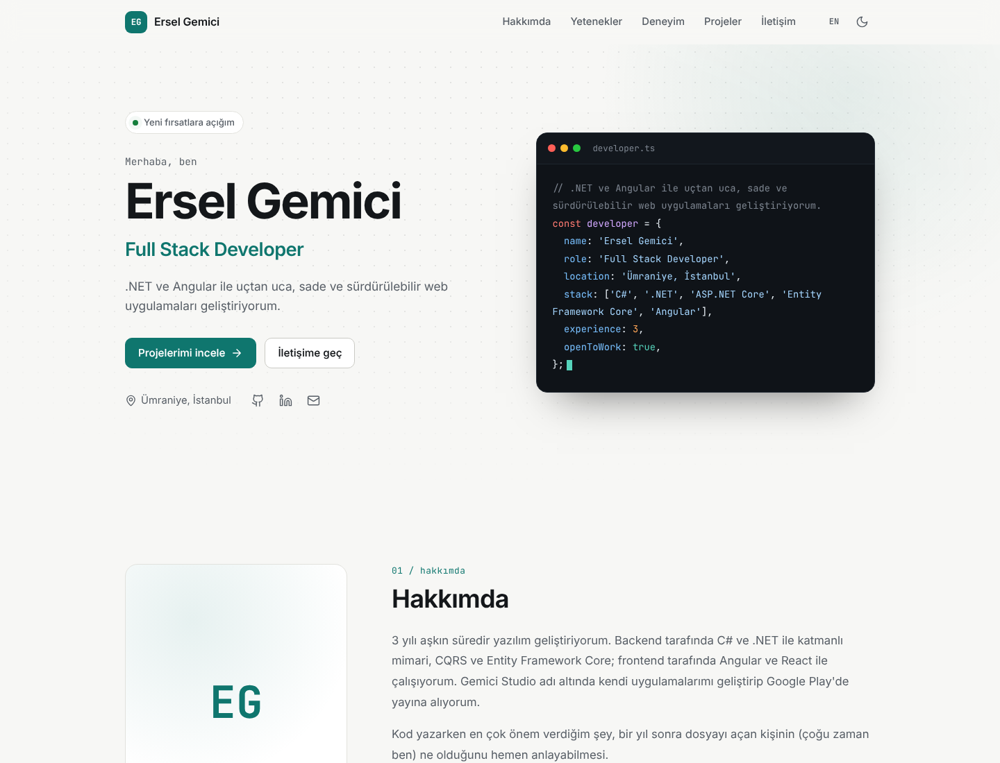
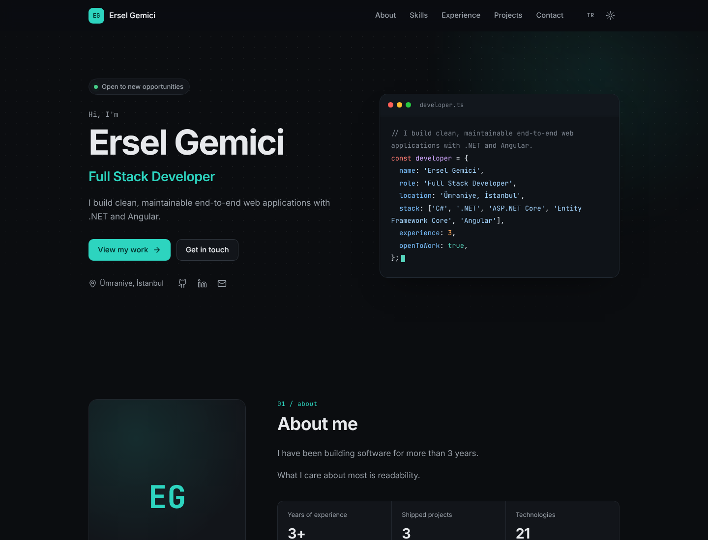
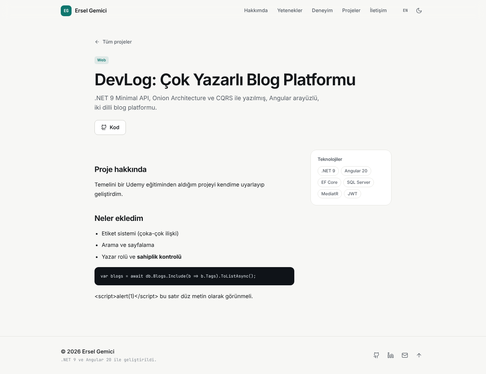
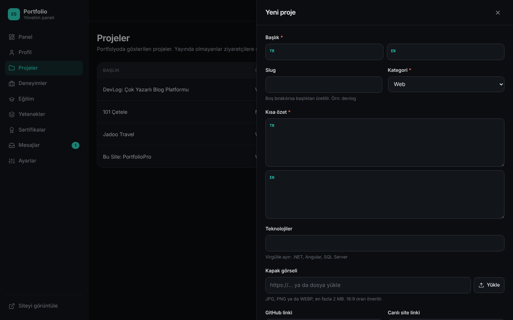
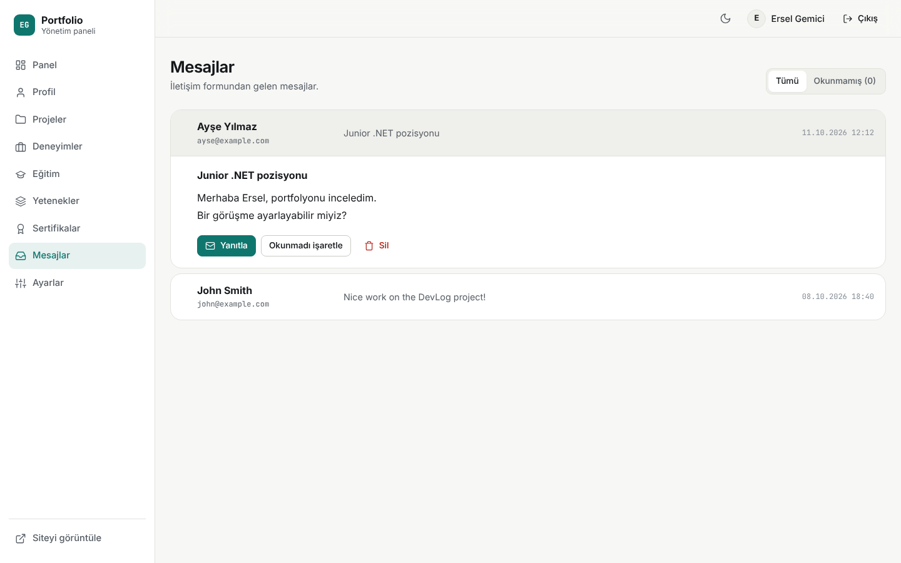

# PortfolioPro

Kişisel portfolyo sitem. Ziyaretçi tarafı ve içeriği yönettiğim bir admin paneli var.
Backend **.NET 9 Web API** (Clean Architecture), frontend **Angular 20**, veritabanı **SQL Server**. Docker ile tek komutla ayağa kalkıyor.

> 🇹🇷 / 🇬🇧 Site Türkçe ve İngilizce, açık ve koyu tema destekliyor.



---

## Özellikler

**Ziyaretçi tarafı**
- Hero, hakkımda, yetenekler, deneyim, projeler, eğitim/sertifika ve iletişim bölümleri
- Proje listesi (kategori filtresi) ve markdown içerikli proje detay sayfası
- TR / EN dil desteği (dil değişince tekrar istek atılmıyor, içerik API'den iki dilli geliyor)
- Açık / koyu tema (sistem temasına uyum, sayfa açılırken beyaz ekran yanıp sönmüyor)
- İletişim formu (honeypot ile bot koruması + rate limit)
- Mobil uyumlu, klavye ile gezilebilir, `prefers-reduced-motion` desteği

**Admin paneli** (`/admin`)
- Profil, projeler, deneyimler, eğitim, yetenekler, sertifikalar için CRUD
- Görsel ve CV (PDF) yükleme
- Gelen mesajlar (okundu/okunmadı, yanıtla, sil)
- Şifre değiştirme (tüm oturumları kapatır)

## Teknolojiler

| Katman | Kullanılanlar |
|---|---|
| Backend | .NET 9, ASP.NET Core Minimal API, MediatR (CQRS), FluentValidation |
| Veri | Entity Framework Core 9, SQL Server, `Select` projeksiyonları, complex type, primitive collection |
| Kimlik | ASP.NET Core Identity, JWT (access token) + refresh token (httpOnly cookie) |
| Frontend | Angular 20: standalone component, signals, yeni control flow (`@if`, `@for`), functional interceptor/guard, lazy loading |
| Altyapı | Docker, Docker Compose, nginx, GitHub Actions |
| Test | xUnit |

## Mimari

```
server/
├── src/
│   ├── PortfolioPro.Domain          → Entity'ler, enum'lar. Hiçbir pakete bağımlı değil.
│   ├── PortfolioPro.Application     → CQRS (command/query + handler), validator, DTO, arayüzler
│   ├── PortfolioPro.Infrastructure  → EF Core, Identity, JWT, dosya kaydetme, seed
│   └── PortfolioPro.API             → Minimal API endpoint'leri, middleware, Program.cs
└── tests/
    └── PortfolioPro.UnitTests       → validator, slug, dosya imzası ve Result testleri

client/                              → Angular 20
├── src/app/core      → servisler, auth, interceptor, guard, i18n, modeller
├── src/app/shared    → ikonlar, proje kartı, markdown, pipe'lar
├── src/app/public    → ziyaretçi sayfaları
└── src/app/admin     → admin paneli (config ile çalışan ortak CRUD sayfası)
```

Bağımlılıklar dıştan içe doğru: `API → Infrastructure → Application → Domain`.
Bir istek şu yolu izliyor: **Endpoint → MediatR → ValidationBehavior → Handler → IAppDbContext → SQL Server**.
Handler'lar HTTP'den habersiz, `Result` dönüyor; API katmanı bunu `200 / 404 / 409` gibi cevaplara çeviriyor.

## Güvenlik

- **Kısa ömürlü access token (15 dk)** sadece tarayıcı belleğinde; localStorage'a yazılmıyor.
- **Refresh token** `httpOnly + Secure + SameSite=Strict` cookie'de. Veritabanında hash'i saklanıyor.
  Her yenilemede yeni token veriliyor (rotation); iptal edilmiş bir token tekrar kullanılırsa kullanıcının tüm oturumları kapatılıyor (reuse detection).
- **Rate limiting**: login (IP başına 5/dk), iletişim formu (IP başına 3/10 dk), genel (120/dk).
- **Hesap kilitleme**: 5 hatalı denemede 15 dk kilit (Identity lockout).
- **Dosya yükleme**: uzantı beyaz listesi + dosyanın ilk byte'larına (magic number) bakarak içerik kontrolü, rastgele dosya adı, boyut sınırı, SVG yasak.
- **XSS**: linkler sadece `http/https` olabiliyor (backend validator). Markdown önce escape ediliyor, sonra Angular tekrar sanitize ediyor.
- **Güvenlik header'ları**: CSP, X-Frame-Options, X-Content-Type-Options, Referrer-Policy (API + nginx).
- **Gizli bilgiler** repoda yok: geliştirmede `user-secrets`, sunucuda ortam değişkenleri (`.env`).
- Hatalar **ProblemDetails** formatında, production'da stack trace dışarı verilmiyor.

## Performans

- Ana sayfa verisi **tek istekte** geliyor ve API'de **OutputCache** ile önbellekte tutuluyor. Admin bir şey değiştirince önbellek otomatik temizleniyor.
- Sorgularda entity yerine `Select` ile sadece gereken kolonlar çekiliyor (N+1 ve gereksiz veri yok).
- Angular sayfaları lazy load ediliyor, ziyaretçi admin kodunu hiç indirmiyor. İlk yükleme ~100 KB (gzip).
- Brotli/Gzip sıkıştırma, hash'li dosyalar için uzun süreli tarayıcı önbelleği.

---

## Kurulum (geliştirme ortamı)

### Gereksinimler
- .NET 9 SDK, Node.js 22, SQL Server LocalDB (Visual Studio ile geliyor)
- EF Core aracı: `dotnet tool install --global dotnet-ef`

### 1. Gizli ayarlar (user-secrets)

```bash
cd server/src/PortfolioPro.API
dotnet user-secrets set "Jwt:Key" "en-az-32-karakterlik-rastgele-bir-deger-buraya"
dotnet user-secrets set "Seed:AdminEmail" "admin@ornek.com"
dotnet user-secrets set "Seed:AdminPassword" "GucluSifre12345"
dotnet user-secrets set "Seed:AdminFullName" "Ersel Gemici"
```

Bağlantı cümlesi `appsettings.Development.json` içinde (LocalDB, `PortfolioProDb`).

### 2. İlk migration

```bash
cd server
dotnet ef migrations add InitialCreate --project src/PortfolioPro.Infrastructure --startup-project src/PortfolioPro.API --output-dir Persistence/Migrations
```

API açılırken bekleyen migration'ları kendisi uygular ve ilk içeriği ekler (`Database:MigrateOnStartup`).

### 3. Çalıştır

```bash
# API -> http://localhost:5080  (Swagger: /swagger)
cd server/src/PortfolioPro.API
dotnet run

# Angular -> http://localhost:4200  (/api istekleri proxy ile API'ye gidiyor)
cd client
npm install
npm start
```

Admin paneli: `http://localhost:4200/admin`

### Testler

```bash
cd server
dotnet test
```

## Docker ile çalıştırma

```bash
cp .env.example .env      # içindeki değerleri değiştir
docker compose up -d --build
```

Site `https://localhost` adresinde açılır (Caddy yerel bir sertifika üretir, tarayıcı ilk seferde uyarı verebilir). SQL Server ve API portları dışarı açık değil, istekler Caddy → nginx üzerinden geçiyor.

## Yayına alma

Docker kurulu bir VPS (en az 4 GB RAM, x86) + alan adı yeterli.

1. Alan adının DNS ayarında `A` kaydıyla domaini sunucunun IP'sine yönlendir (`@` ve `www`).
2. Sunucuya repoyu çek, `.env` dosyasını oluştur ve `DOMAIN=alanadin.com` yaz.
3. `docker compose up -d --build`. Caddy HTTPS sertifikasını otomatik alır.

> **HTTPS zorunlu:** refresh token cookie'si `Secure` olduğu için admin girişi sadece HTTPS üzerinde çalışır (localhost hariç).

> `client/src/index.html` içindeki tema script'ini değiştirirsen, `client/nginx.conf` içindeki CSP hash'ini de güncellemen gerekir. Yoksa tarayıcı script'i engeller.

## Ekran görüntüleri

| | |
|---|---|
|  |  |
|  |  |

## İletişim

[LinkedIn](https://www.linkedin.com/in/ersel-gemici) · [GitHub](https://github.com/erselgemici)
